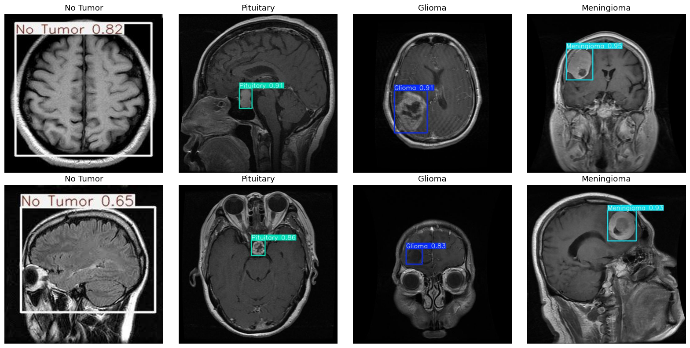

# Brain Tumor Detection Using Deep Learning

This repository implements a YOLOv8-based brain tumor detector for MRI images.

## Table of Contents
- [Introduction](#introduction)
- [Features](#features)
- [Repository Structure](#repository-structure)
- [Requirements](#requirements)
- [Installation](#installation)
- [Usage](#usage)
- [Sample Output](#sample-output)
- [Dataset](#dataset)
- [Future Enhancements](#future-enhancements)
- [Acknowledgements](#acknowledgements)
- [License](#license)

---

## Introduction

The Streamlit app uses a YOLOv8 detector to locate and classify Glioma, Meningioma, Pituitary tumors, and normal cases from MRI scans. Model output is not a medical diagnosis.

---

## Features

- **Object Detection**: YOLOv8 localizes and classifies tumor regions within MRI scans.
- **Training**: Validates annotations and evaluates on labeled validation images.
- **Visualization**: Displays bounding boxes and class predictions for uploaded images.

---

## Repository Structure

```
brain-tumor-detection/
├── app.py                 # Streamlit detection app
├── train_model.py         # Dataset validation and YOLO training
├── data/                  # MRI images, YOLO labels, and data.yaml
├── models/                # Best checkpoint copied here after training
├── runs/                  # Training outputs and validation metrics
├── requirements.txt       # Dependencies
└── README.md              # Project documentation
```

---

## Requirements

Ensure you have Python 3.8+ installed. Install the dependencies using:

```bash
pip install -r requirements.txt
```

---

## Installation

1. Clone the repository:
   ```bash
   git clone https://github.com/<your-username>/brain-tumor-detection.git
   ```
2. Navigate to the project directory:
   ```bash
   cd brain-tumor-detection
   ```

---

## Usage

1. **Dataset**: The YOLO dataset should contain `data/train/images`, `data/train/labels`, `data/val/images`, and `data/val/labels`.
2. **Activate and validate the existing detector** from the project root:
   ```bash
   python train_model.py --existing-checkpoint runs/detect/train9/weights/best.pt
   ```
   The trainer validates labels, excludes validation images without a matching
   annotation, removes exact-image train/validation overlap and duplicate
   samples, corrects the class-name mapping, evaluates the checkpoint, and saves
   it to `models/brain_tumor_yolo_best.pt`.
   To retrain from pretrained YOLOv8 weights, run:
   ```bash
   python train_model.py --epochs 100 --batch-size 8
   ```
   CUDA is used when available; CPU-only training can take many hours.
3. **Run the app**:
   ```bash
   streamlit run app.py
   ```
4. **Legacy experiments**: `BrainTumorYOLO&GoogleNet&VIT.ipynb` is not used by the app.

---

## Sample Output

Here is an example of how the system's output looks:



The image shows:
- Bounding boxes around detected tumors.
- Classification labels for each tumor.

---

## Dataset

The dataset consists of MRI images categorized as:
- **Glioma**
- **Meningioma**
- **Pituitary Tumors**
- **No Tumor**

---

## Future Enhancements

- **Multimodal Data**: Integrate additional MRI modalities (T1, T2, FLAIR) for enhanced generalization.
- **Advanced Models**: Experiment with attention mechanisms and transformers for better feature extraction.
- **Clinical Validation**: Test the system in real-world medical settings to ensure reliability.

---

## Acknowledgements

- [YOLOv5](https://github.com/ultralytics/yolov5)
- [Vision Transformer (ViT)](https://arxiv.org/abs/2010.11929)
- [Google Research](https://github.com/google-research/vision_transformer?utm_source=catalyzex.com)
- [GoogleNet](https://arxiv.org/abs/1409.4842)
- [Kaggle Dataset](https://www.kaggle.com/datasets/ahmedsorour1/mri-for-brain-tumor-with-bounding-boxes)

---

## License

This project is licensed under the MIT License. See the `LICENSE` file for details.
